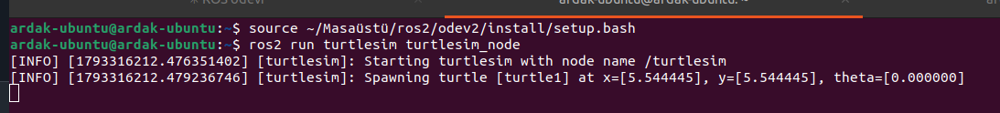
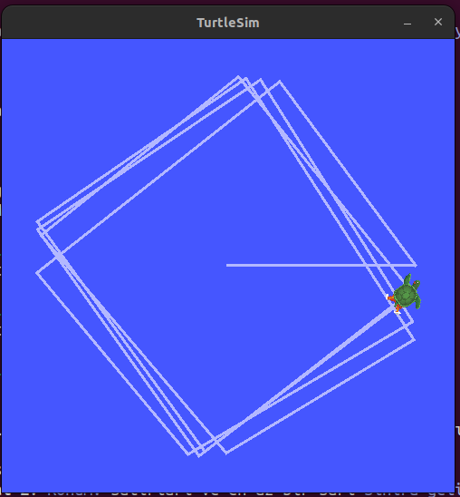
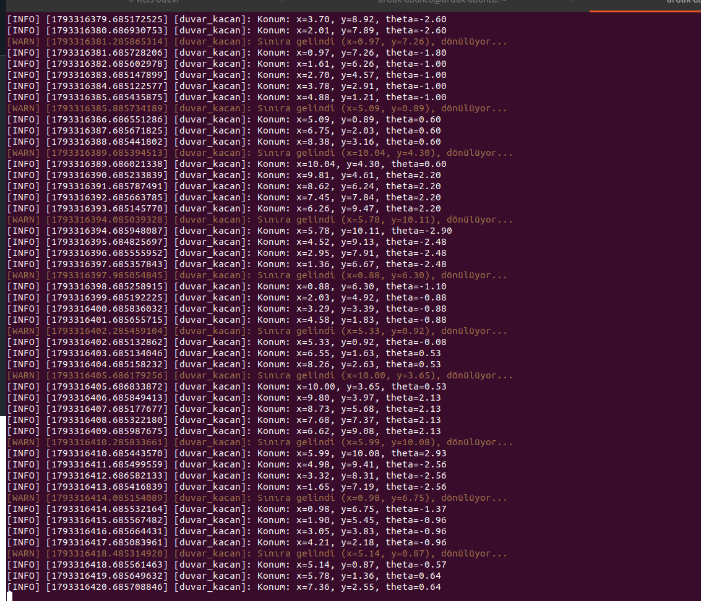
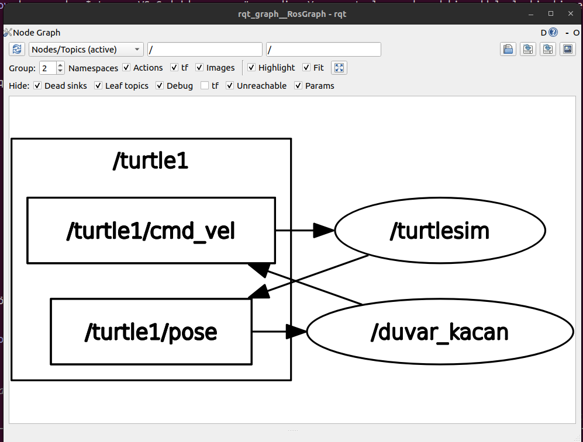

# turtle_duvar_py — Duvardan Kaçan Kaplumbağa

ROS2 Humble ile yazılmış bir turtlesim uygulaması. `duvar_kacan` düğümü kaplumbağayı ileri sürer; kaplumbağa belirlenen sınırların dışına çıkınca (x veya y, 1.0'dan küçük ya da 10.0'dan büyük) yerinde dönerek yön değiştirir ve tekrar içeri doğru ilerler.

```
turtlesim_node --( /turtle1/pose : turtlesim/msg/Pose )-->  duvar_kacan
turtlesim_node <--( /turtle1/cmd_vel : geometry_msgs/msg/Twist )--  duvar_kacan
```

## Nasıl çalışır?

| Görev | Uygulama |
|---|---|
| **Abone** | `/turtle1/pose` konusundan `x`, `y`, `theta` değerleri alınır. |
| **Yayıncı** | Saniyede 10 kez `/turtle1/cmd_vel` konusuna `Twist` komutu gönderilir. Sınır içindeyken `linear.x = hiz` (ileri), sınır dışındayken ve yüzü hâlâ dışarı dönükken `angular.z = donus_hizi` (yerinde dönüş). Kaplumbağanın yüzü içeri döndüğünde tekrar ileri gider. |
| **Log** | Konum saniyede bir `get_logger().info()` ile yazdırılır. Sınıra gelindiğinde `warn` ile uyarı verilir. |

## Gereksinimler

- Ubuntu 22.04, ROS2 Humble
- `rclpy`, `geometry_msgs`, `turtlesim`

## Derleme

```bash
mkdir -p ~/ros2_ws/src
cd ~/ros2_ws/src
git clone <bu deponun adresi> turtle_duvar_py

cd ~/ros2_ws
source /opt/ros/humble/setup.bash
colcon build --packages-select turtle_duvar_py
source install/setup.bash
```

## Çalıştırma

**Terminal 1 – simülatör:**
```bash
ros2 run turtlesim turtlesim_node
```

**Terminal 2 – düğüm:**
```bash
ros2 run turtle_duvar_py duvar_kacan
```

Örnek çıktı:
```
[INFO] [duvar_kacan]: Konum: x=9.35, y=5.54, theta=0.00
[WARN] [duvar_kacan]: Sınıra gelindi (x=10.15, y=5.54), dönülüyor...
[INFO] [duvar_kacan]: Konum: x=8.12, y=7.03, theta=2.10
```

## Bonus: Parametreler

| Parametre | Varsayılan | Açıklama |
|---|---|---|
| `hiz` | `2.0` | İleri hız (birim/sn) |
| `donus_hizi` | `2.0` | Dönüş hızı (rad/sn) |
| `alt_sinir` | `1.0` | x ve y için alt sınır |
| `ust_sinir` | `10.0` | x ve y için üst sınır |

Başlatırken değiştirmek için:
```bash
ros2 run turtle_duvar_py duvar_kacan --ros-args -p hiz:=3.0 -p alt_sinir:=2.0 -p ust_sinir:=9.0
```

Çalışırken değiştirmek için:
```bash
ros2 param set /duvar_kacan hiz 4.0
```

## Ekran görüntüleri

**Simülatörün başlatılması:**



**Kaplumbağanın izlediği yol:**



**Terminal çıktısı:**



**rqt_graph:**


